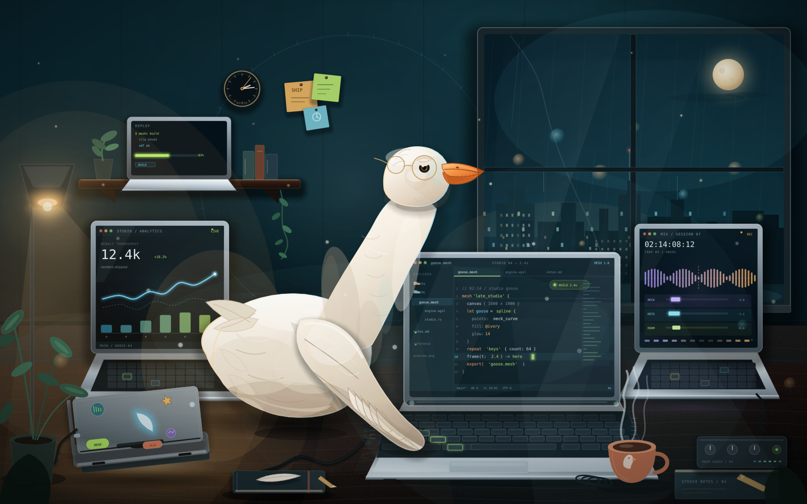
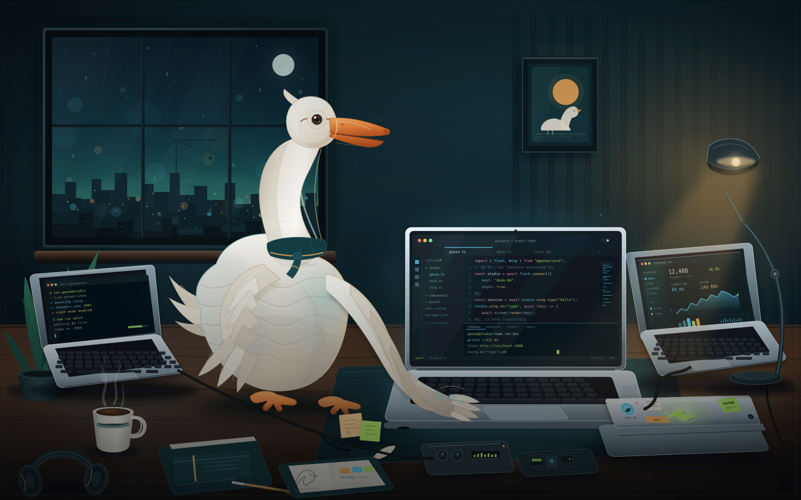

# Mesh

[](https://github.com/sysv86/Mesh/actions/workflows/ci.yml)

Mesh is a declarative 2D vector graphics engine and compiler. A `.mesh`
document contains shapes, typography, gradients, SDF effects, components,
constraints and animation; the native engine rasterizes it through a
tile-binned SDF pipeline and can also emit PNG, GIF, MP4/MOV (H.264), sprite
sheets, SVG, HTML, WGSL and GLSL.

See [`AGENTS.md`](AGENTS.md) for the repository map, architecture, build/test
workflow and contribution rules.

## Build

```bash
make -j"$(nproc)"
```

This produces `build/meshc`, `build/libmesh.a` and `build/test_suite`.

FreeType, HarfBuzz and Fontconfig are discovered with `pkg-config` and are
optional. With them installed, text uses real TTF/OTF/TTC glyph outlines. A
zero-dependency build still compiles and falls back to the deterministic
built-in vector font.

FFmpeg (`libavcodec`, `libavformat`, `libavutil`, `libswscale`) is also optional
and detected with `pkg-config`. When present, `meshc animate` can write native
H.264 MP4/MOV files through the C libraries — no `ffmpeg` executable is needed
at build time or runtime. Without FFmpeg, all other formats still build and
work; MP4 requests return a clear error and `mesh::mp4_export_supported()`
returns `false`.

CMake works too:

```bash
cmake -S . -B build-cmake -DCMAKE_BUILD_TYPE=Release
cmake --build build-cmake -j"$(nproc)"
```

On Debian/Arch-style systems the native font stack is typically provided by
`freetype2`, `harfbuzz` and `fontconfig` development packages.

## Quick start

```bash
./build/meshc validate examples/09_typography_specimen.mesh
./build/meshc render examples/09_typography_specimen.mesh -o specimen.png --aa 4
./build/meshc inspect examples/09_typography_specimen.mesh
./build/meshc fonts
make test
make examples
```

Useful commands:

```bash
./build/meshc render input.mesh -o out.png [--aa 4] [--time 0.5]
./build/meshc pack   input.mesh -o out.meshb
./build/meshc render out.meshb -o out.png
./build/meshc unpack out.meshb -o restored.mesh
./build/meshc compile input.mesh --target svg  -o out.svg
./build/meshc compile input.mesh --target html -o out.html
./build/meshc import drawing.svg -o drawing.mesh
./build/meshc animate input.mesh -o out.gif --duration 2 --fps 20
./build/meshc animate input.mesh -o out.mp4 --duration 2 --fps 30
```

## Video export (MP4 / MOV)

`meshc animate` selects the encoder from the output extension. `.png` writes a
horizontal sprite sheet and `.gif` writes GIF89a; `.mp4` and `.mov` use the
native H.264 backend:

```bash
./build/meshc animate examples/01_aurora_card.mesh -o aurora.mp4 \
  --duration 3 --fps 30 --width 1280 --height 720 --aa 4
```

The backend renders each timestamp through the same `parse_and_evaluate` +
`render_scene_ex` path as the GIF/spritesheet exporters, converts RGBA to
YUV420P with libswscale, and muxes H.264 with libavformat. Defaults are CRF 18,
preset `medium`, no audio, `+faststart`, H.264 High profile in an MP4 container,
and the scene name as the media title. Frames are timestamped at `frame / fps`
deterministically. `yuv420p` requires even dimensions: an odd canvas is rounded
up by one pixel and padded with the scene background (black if none).

The public C++ API is `mesh::render_animation_mp4(...)`; the C API mirror is
`mesh_render_mp4_file(...)`. Both work only when `mesh::mp4_export_supported()`
is `true`.

## Typography

`font` blocks declare a reusable face, either by local file or by family name:

```mesh
canvas {
  width: 1200
  height: 800
  font_family: "Open Sans"      // document default
  font_fallback: "Noto Sans"
}

font "display" {
  src: "fonts/OpenSans-Bold.ttf" // relative to the .mesh file
  family: "Open Sans"
  fallback: "Noto Sans, DejaVu Sans"
  weight: 700
  style: normal
  stretch: 100
}

text {
  at: (64, 120)
  baseline: true
  content: "Type is geometry."
  size: 96
  font: "display"
  letter_spacing: 0.5
  line_height: 1.2
  max_width: 520
  wrap: true
  fill: #F0F6FC
}
```

- Fonts are shaped with HarfBuzz (kerning, ligatures, features, language,
  per-character fallback) and converted to real outlines at parse time.
- Text accepts `font`, `font_family`, `font_src`, `font_fallback`,
  `font_style`, `font_stretch`, `font_features`, `font_language`, `size`,
  `weight`, `align`, `letter_spacing`, `word_spacing`, `line_height`,
  `max_width`, `wrap` and `baseline`.
- `at:` is the visual centre of the ink by default. Set `baseline: true` for
  SVG-style first-baseline anchoring.
- Text outlines use the same paint/effect pipeline as paths: gradients,
  strokes, grain, shadows, glows, dashes, clips, Boolean composition, blend
  modes and transforms. A text node can itself be used as a `clip:` target.
- `font_family: "First, Second, Third"` treats the first family as primary and
  the rest as fallbacks.

`examples/09_typography_specimen.mesh` is a self-contained showcase using the
bundled Open Sans faces in `examples/fonts/`. Open Sans is distributed under
the SIL Open Font License 1.1; the license text is kept in
`examples/fonts/OFL.txt`.

## Examples

| File | Showcase |
| :--- | :--- |
| `01_aurora_card.mesh` | Aurora glass card, OKLCH color, gradients |
| `02_ai_topology_graph.mesh` | Relational anchors and graph layout |
| `03_sdf_metaballs_mesh.mesh` | SDF metaballs and mesh gradients |
| `04_x_neural_bento_widget.mesh` | Bento dashboard, components, time |
| `05_win95_desktop.mesh` | Windows 95 desktop recreation |
| `06_win8_start.mesh` | Windows 8 Start screen |
| `07_aero_glass.mesh` | Windows 7 Aero glass desktop |
| `08_win11_fluent.mesh` | Windows 11 Fluent settings |
| `09_typography_specimen.mesh` | Native font import, weights, wrapping, effects |
| `10_goose_mesh.mesh` | Animated Mesh goose + MacBooks, 1600×1000, 30 fps MP4 |
| `11_goose_svg.svg` | Animated SVG goose + MacBooks, 1600×1000, 30 fps MP4 |

The goose showcase includes source, MP4 renders, still PNGs and an animated
side-by-side comparison in `examples/10_goose_*` and `examples/11_goose_*`.

### Goose showcase — Mesh vs SVG

Click a still to open the 1600×1000, 30 fps, 6-second H.264 MP4.

| Mesh | SVG |
| :---: | :---: |
| [](examples/10_goose_mesh.mp4) | [](examples/11_goose_svg.mp4) |
| [MP4](examples/10_goose_mesh.mp4) · [Source](examples/10_goose_mesh.mesh) | [MP4](examples/11_goose_svg.mp4) · [Source](examples/11_goose_svg.svg) |

[Side-by-side comparison video](examples/10_goose_comparison.mp4) ·
[comparison still](examples/10_goose_comparison.png).

## Tests

```bash
make test
```

The suite covers geometry, SDF Boolean operations, gradients, components,
animation expressions, binary round-trips, SVG import/export, MP4 export (when
the FFmpeg backend is compiled in), the C API and real-font
shaping/layout/rendering when the native font backend is present.
